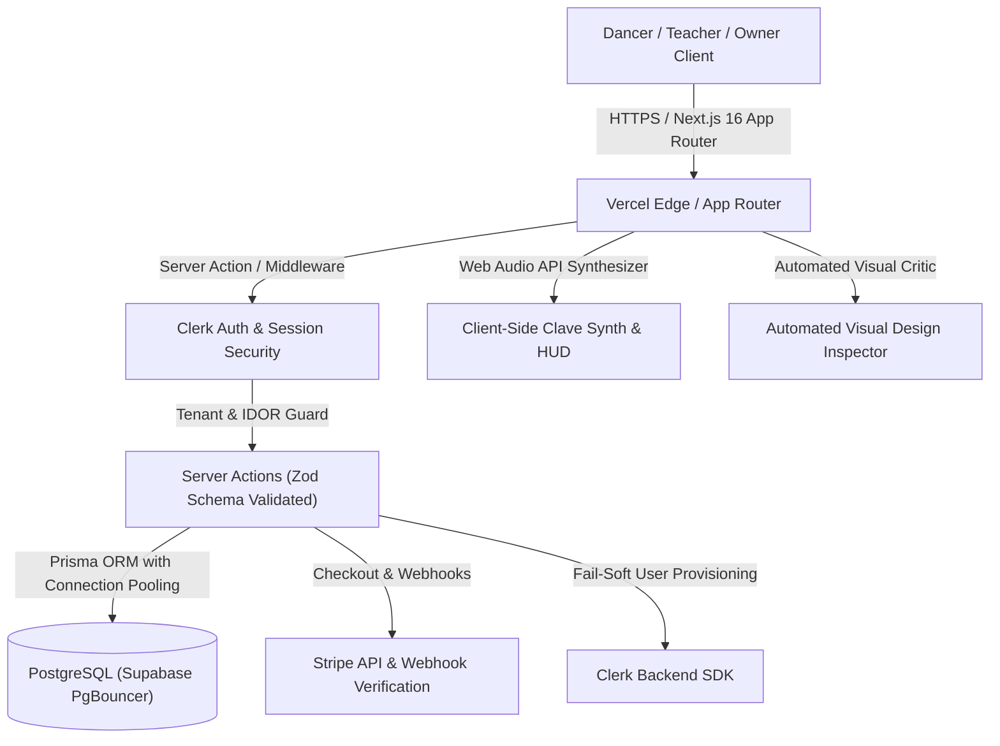

# Salsa Explosion (RitmoFlow) 🇨🇺
### Full-Stack Dance Academy, Multi-Role Studio Management & Event Commerce Platform

[](https://nextjs.org/)
[](https://www.typescriptlang.org/)
[](https://tailwindcss.com/)
[](https://www.prisma.io/)
[](https://supabase.com/)
[](https://clerk.com/)
[](https://vitest.dev/)
[](https://playwright.dev/)

> **Live Production Platform:** [salsa-explosion-bkgf.vercel.app](https://salsa-explosion-bkgf.vercel.app/)  
> **Flagship Residency:** BOH Studios, 104 Commercial Rd, Bournemouth, UK  
> **Heritage:** Directed by Salsa UK Lifetime Achievement Award winner Maestro Enrique Perez Valdes (25+ years UK teaching heritage, 4,200+ dancers mentored).

---

## 🌟 Executive Overview

**Salsa Explosion (RitmoFlow)** is a production-grade, multi-tenant workspace application built to modernize physical dance studio operations. Designed around the real-world operational rhythm of Bournemouth's premier Cuban Salsa academy, the system bridges physical door ticketing (£12 / £14 pay-at-the-door) with online event commerce, student syllabus progression, real-time polyrhythmic audio training, and multi-persona role switching.

Engineered with **Next.js 16 App Router**, **TypeScript (Strict Mode, 0 `any`)**, **Prisma ORM**, **Supabase PostgreSQL**, **Clerk Authentication**, and **Stripe**, the application is backed by an automated 230-test Vitest unit suite, Playwright end-to-end integration, and a custom automated visual design critic.

---

## 🏗️ Architecture & Core System Design



### 1. Architectural Discipline & Server/Client Boundaries
- **Server Components by Default:** Push `"use client"` strictly to the leaves of the DOM tree (interactive audio scrubbers, modal sheets, and tab filters) to ensure ultra-low Total Blocking Time (TBT) and minimal client bundle size.
- **Strict Server Actions with Zod Validation:** All mutations (class bookings, pass purchases, QR attendance check-ins, student submissions) are processed via server actions with runtime Zod schema parsing, preventing parameter tampering.
- **Fail-Soft User Provisioning:** Integrated fallback handlers that smoothly provision or reconcile user database records even during third-party webhook latency or rate limits.

### 2. Multi-Role RBAC (Role-Based Access Control)
Supports 3 distinct operational personas with zero credential or data leakage:
- **Dancer (Student):** Personal timetable, class progression tracking, QR wallet passes, song analyzer, and event booking.
- **Teacher (Instructor):** Real-time mobile QR class scanner, student level progression, submission grading, and attendance verification.
- **Owner (Admin):** Full studio operations workspace, revenue analytics, door check-ins, coach assignment, and audit logs.
- *Testing Sandbox:* Includes an environment-guarded demo role switcher with strict production locks (`ALLOW_DEMO_ROLE_SWITCHING=false`).

### 3. Native Web Audio Engine & Real-Time Telemetry
- **Browser-Native Clave Synthesizer (`CubanRhythmSynth`):** Generates authentic 2-3 Son, 3-2 Son, 2-3 Rumba, and 6/8 Afro-Bembé clave pulses using the Web Audio API without downloading external audio files (£0/month overhead, zero latency).
- **Two-Way Video Telemetry:** Bi-directional synchronization between YouTube video streams and a live **Dancer HUD**, providing real-time gear-shift guidance, 3-zone body telemetry (Chest, Hips, Feet), and caller hand signals.

### 4. Zero Layout Shift Media Manifest
- Centralized media pipeline (`src/lib/media-manifest.ts`) defining canonical aspect ratios, intrinsic widths/heights, and responsive image configurations.
- Guarantees **0 Cumulative Layout Shift (CLS)** across mobile and desktop devices.

### 5. Automated Visual Design & UI Critic (`scripts/visual-audit.mjs`)
- An in-tree automated audit tool built with Playwright that captures high-resolution Desktop (`1440x900`) and Mobile (`390x844`) screenshots of all core routes.
- Programmatically evaluates:
  - **Typography Entropy:** Flags pages exceeding 9 distinct font-size combinations.
  - **Color Bleed:** Detects computed colors falling outside the approved Obsidian (`#080706`), Warm Ivory, and Havana Crimson design tokens.
  - **Focal Point Clipping:** Verifies image aspect ratios and portrait focal alignment (`object-top`).
  - **Touch Target Ergonomics:** Flags any interactive link or button smaller than the 40px mobile thumb comfort standard.
  - **Mobile Overflow:** Asserts `scrollWidth === innerWidth` on 390px mobile viewports.

---

## 🗄️ Database Schema & Domain Models

The platform uses PostgreSQL hosted on Supabase, managed via Prisma ORM:

| Model | Purpose | Key Relationships |
| :--- | :--- | :--- |
| **`User`** | Unified account entity linked to Clerk identity | `Role`, `Bookings`, `Attendances`, `Submissions`, `Referrals` |
| **`ClassSession`** | Weekly Thursday/Sunday studio sessions at BOH Studios | `Instructor`, `Attendances`, `Level` |
| **`Event`** | Special congresses, bank holiday weekenders & costume parties | `TicketTiers`, `Bookings`, `Venue` |
| **`Booking`** | Online pass purchases with Stripe payment intent tracking | `User`, `Event`, `TicketTier` |
| **`Attendance`** | Physical door check-ins and QR-scanned admissions | `User`, `ClassSession` |
| **`StudentSubmission`** | Video submissions for syllabus skill accreditation | `User`, `Instructor`, `Skill` |
| **`AuditLog`** | Forensic security log recording critical actions and role changes | `ActorId`, `Action`, `Metadata` |

---

## 🧪 Testing Rigorousness

The codebase enforces a zero-regression policy across 38 Vitest suites and Playwright E2E tests:

```bash
# Run the complete Vitest unit test suite (38 suites, 230 tests)
npm test

# Run the Playwright end-to-end integration suite
npm run test:e2e

# Run the automated visual design critic and ergonomics audit
npm run audit:design
```

### Key Test Coverage Highlights:
- **`idor-ownership.test.ts`:** Proves dancers cannot read or cancel another student's tickets, passes, or submissions.
- **`auth-role-escalation.test.ts`:** Proves non-admins cannot invoke admin server actions or elevate privileges.
- **`webhook-safeguards.test.ts`:** Proves production aborts if Stripe/Clerk webhook secrets are missing or placeholder tokens.
- **`media-manifest.test.ts`:** Asserts all photography assets on disk exist, are > 10KB, and contain zero raw unoptimized external URLs.
- **`timba-song-anatomy.test.ts`:** Validates continuous, frame-accurate timing segments and curriculum mapping across all benchmark tracks.

---

## 🚀 Quickstart & Local Setup

### Prerequisites
- Node.js 20+
- PostgreSQL database (local or Supabase connection pool)
- Clerk API keys
- Stripe API test keys

### 1. Clone & Install
```bash
git clone https://github.com/DragostinJ/SalsaExplosion.git
cd SalsaExplosion
npm install
```

### 2. Configure Environment Variables
Copy `.env.example` to `.env`:
```bash
cp .env.example .env
```
Fill in your database connection string and Clerk/Stripe credentials.

### 3. Generate Prisma Client & Run Migrations
```bash
npx prisma generate
npm run db:push
npm run db:seed
```

### 4. Start Development Server
```bash
npm run dev
```
Open [http://localhost:3000](http://localhost:3000) to view the application.

---

## 📱 Core Routes

- `/` — Editorial Split Hero, Core Photo Gateways, What's On Posters, Faculty Roster, Inside the Cuban Circle, BOH Studios Venue Guide.
- `/music` — Interactive Timba Song Anatomy Player, Web Audio Clave Synthesizer, 3-Zone Body Telemetry, and BPM guide.
- `/events` — Online ticket box office for flagship festivals (Made in Cuba Dance Weekend 2026, Halloween Party, SB&K Nights).
- `/dashboard/schedule` — Weekly Thursday & Sunday timetable, door pricing guide (£12 / £14), and BOH Studios arrival planner.
- `/dashboard/rueda` — Comprehensive Havana Rueda de Casino call dictionary with caller hand gestures and 4-tier syllabus breakdown.
- `/about` — Academy heritage, Maestro Enrique Perez Valdes biography, and BOH Studios Canadian sprung maple floor specifications.
- `/admin/operations` — Studio owner dashboard: real-time attendee roster, revenue analytics, coaching requests, and audit logs.

---

## 🛡️ Security, Reliability & Compliance

- **No `any` Policy:** Strict TypeScript compilation with exhaustive typing across database queries, server actions, and UI components.
- **Content Security Policy (CSP):** Rigorous HTTP security headers restricting external script and style execution.
- **Database Connection Pooling:** Configured with PgBouncer/Supavisor to prevent serverless connection exhaustion.
- **Rate Limiting:** Built-in sliding-window rate limiters protecting authentication, checkout, and search endpoints.

---

## 📄 License

Private repository built for **Salsa Explosion UK** and **BOH Studios Bournemouth**. All rights reserved.
Developed by **Dragostin J.** as part of an Advanced Full-Stack Software Engineering portfolio.
