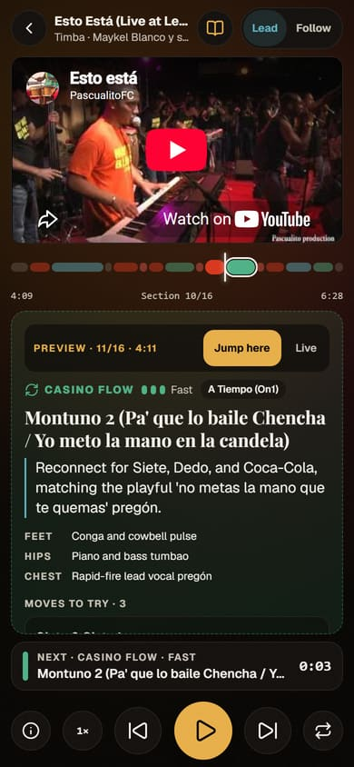
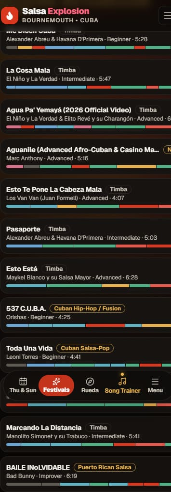
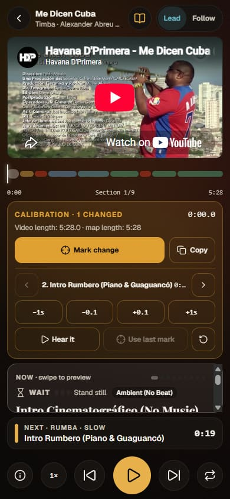
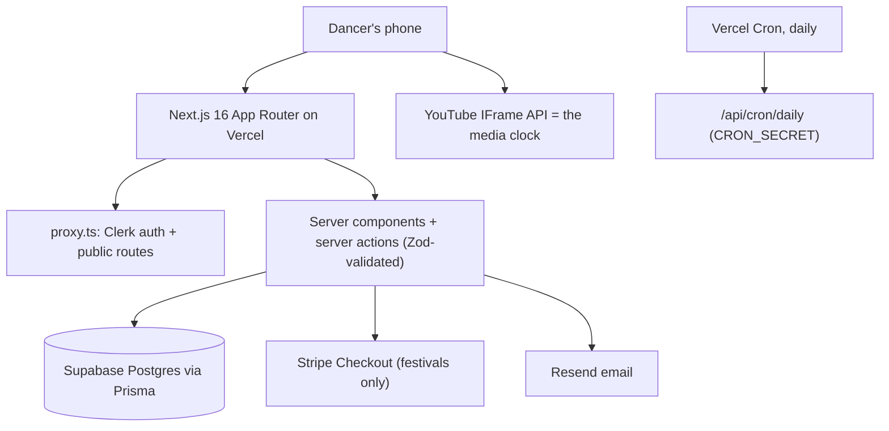
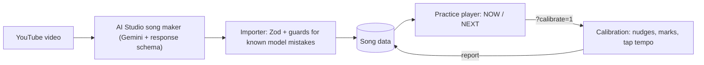

# RitmoFlow · Salsa Explosion

**A practice app and studio platform for a real Cuban salsa school in Bournemouth.** Dancers open a song on their
phone and the app tells them, in time with the music, what to dance *now* and what's coming *next*. Around it:
the weekly timetable, festival ticketing, teacher tools and class emails.

[](https://github.com/DragostinJ/SalsaExplosion/actions/workflows/ci.yml)


**Live:** [salsa-explosion.vercel.app](https://salsa-explosion.vercel.app) ·
**Try the player:** [/music](https://salsa-explosion.vercel.app/music) ·
**Art-direction study:** [/mockups](https://salsa-explosion.vercel.app/mockups) ·
**Case study:** [docs/case-study.md](docs/case-study.md)

<p>
  
  
  
</p>

## What it does

| For | Feature |
|---|---|
| **Dancers** | 14 songs mapped section by section (169 sections, 75 minutes of music). Full-screen, one-screen phone player driven by the YouTube clock: NOW card, NEXT countdown, loop a section, slow down, swipe to preview, share a link to an exact section. |
| **Teachers** | Pick "tonight's songs" for a class; students get them on check-in and in their class recap. A practice-hotspots page shows which sections students loop and replay most. |
| **The studio** | Weekly classes stay pay-at-the-door (£12 / £14, no online payment by design). Festivals sell passes through Stripe Checkout. Class reminders and a weekly owner digest are built in (with one-click unsubscribe); sending switches on with an email API key. |
| **Song curators** | Song maps come from an AI Studio "song maker" (Gemini), go through an importer that catches the model's known mistakes, and are then fine-tuned by ear in a calibration mode with tap-tempo beat fitting. |

## Engineering highlights

Each one has the full story and numbers in the [case study](docs/case-study.md).

- **Timing you can trust from an AI that guesses.** I benchmarked three Gemini setups on the same songs. The best
  one (Gemini 4 Argon) agreed with itself within 0.5 s on 9 of 11 section starts; another matched only 4. The
  importer now repairs or flags each failure I saw: "1:18" typed as 118 s, invented video ids, double-time BPM,
  songs copied from an earlier chat.
- **Beat maths for humans.** Tap-tempo calibration fits a least-squares beat grid through your taps, so 32 taps that
  are each ±40 ms off still place the beats within about 10 ms.
- **A 96 KB bundle leak found and fixed.** Two innocent imports pulled every song's data into the player page.
  Moving them cut the player's JavaScript from 1,202 KB to 1,106 KB, and it no longer grows as songs are added.
- **Measured, not guessed.** A layout jump in the NEXT strip was traced frame by frame during real playback
  (55 → 71 px at 360 px wide) and fixed so that it measures 0 px.
- **Security reviewed, including the AI agents' work.** Content-Security-Policy, IDOR tests, signed unsubscribe
  links, a fail-closed cron secret, rate limits, and an RLS plan for the database. Reviewing an agent's branch
  caught it removing the live CSP, and a security test that passed only because of a code comment.

## Architecture





Principles: **single sources of truth** (schedule, prices and venue in
[`academy-data.ts`](src/lib/academy-data.ts), songs in [`timba-song-anatomy.ts`](src/lib/constants/timba-song-anatomy.ts),
images in [`media-manifest.ts`](src/lib/media-manifest.ts)), **the media clock is the only timer** (no simulated
timing), and **strict YouTube terms** (player never covered, never hidden, never under 200×200 px).

## Quality gates

Every change, mine or an AI agent's, has to pass all of these. CI runs the first four on every branch push.

```bash
npx tsc --noEmit        # strict TypeScript, no `any`
npm run lint            # ESLint
npm test                # Vitest: 53 files, 350 tests (IDOR, role escalation, webhooks, CSP, importer, tap tempo…)
npm run build           # production build
npm run audit:design    # Playwright design critic: overflow, ≤ 9 font sizes, 40 px touch targets, natural-colour photos
npx playwright test     # e2e: player tools, routes, guards, layout shift
```

A weekly GitHub Action also checks that every song's YouTube video still exists (and, with a YouTube API key,
still has the length the map was timed for), opening an issue if not.

## Working with AI agents

Built by one developer working with three AI tools, each in its own lane:

| Tool | Role |
|---|---|
| **Claude Code** | Feature work on branches, reviews, verification. |
| **Gemini in Google AI Studio** | The song maker; image generation (Nano Banana). |
| **Google Antigravity** | Long unattended briefs: tests, upgrades, reports. |

The rules live in [`AGENTS.md`](AGENTS.md): business invariants (weekly classes are never sold online), design
tokens, and the gates above. Agents work on branches; nothing reaches `main` without passing every gate and
being reviewed.

## Run it locally

```bash
git clone https://github.com/DragostinJ/SalsaExplosion.git && cd SalsaExplosion
npm install
cp .env.example .env     # database, Clerk and Stripe test keys
npx prisma generate && npm run db:push && npm run db:seed
npm run dev              # http://localhost:3000
```

Main routes:
- `/`: home
- `/music` and `/music/[songId]`: song list and practice player (`?calibrate=1` for curators)
- `/dashboard/schedule`: weekly timetable
- `/events`: festivals and tickets
- `/instructor/*`: teacher tools (roster, song maps importer, practice hotspots)
- `/admin/*`: studio operations

## Credits

Built for **Salsa Explosion UK** (Maestro Enrique Perez Valdes) at BOH Studios, Bournemouth, by **Dragostin J.**
Songs play through YouTube's official embedded player from their owners' uploads. The editorial images on
`/mockups` are AI-generated (Nano Banana Pro); real teachers and the venue appear only in real photos.
