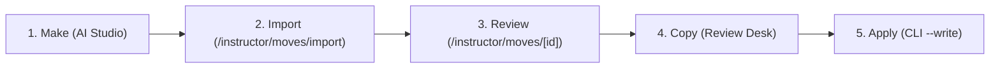

# AI Studio Move Maker & Review Workflow

How to draft rich, anatomically accurate move entries with Google AI Studio and shepherd them through teacher verification into the RitmoFlow curriculum.

Both setup files here are generated directly from the application's Zod schemas and enums:
Re-run `npx tsx scripts/ai-studio-move-maker.ts` whenever categories, levels, rueda calls, or curriculum items are updated.

---

## The Complete Move Lifecycle: Make → Import → Review → Copy → Apply



### Step 1: Make (Drafting in Google AI Studio)
1. Open [Google AI Studio](https://aistudio.google.com/) -> Playground.
2. Select **Gemini 2.5 Pro** or **Gemini 4 Argon**.
3. Set **System instructions** to the contents of [`system-instructions.txt`](system-instructions.txt).
4. Turn **Structured outputs** ON and paste [`response-schema.json`](response-schema.json).
5. Turn search/code tools OFF.
6. Prompt Gemini with the move name, level, and category (e.g., *"Draft the Cuban dance entry for 'Enchufla Doble'"*).
7. Copy the structured JSON response.

### Step 2: Import (Review Queue Ingestion)
1. As an instructor, navigate to **`/instructor/moves/import`**.
2. Paste the Gemini JSON output into the console.
3. Click **"Validate Move JSON"**. The console checks for schema violations, unrecognized Rueda calls, and step-count discrepancies.
4. Click **"Add to Review Report"**. The move enters the unapproved draft queue.

### Step 3: Review & Ear-Verification (Teacher Desk)
1. Open the move in **`/instructor/moves/[moveId]`** on a phone or desktop.
2. Review the breakdown: edit summary, refine leader/follower steps, and adjust eight-counts if needed.
3. **Listen to the Music:** Under *"Practise It in These Songs"*, click any deep link (e.g. `/music/me-dicen-cuba?section=pupy-seg-3`) to open the practice player at that exact cue.
4. **Attach Videos:** Search YouTube or paste tutorial URLs. The system validates embeddability and extracts creator attribution via oEmbed. Set optional `start` and `end` times.
5. **Verify Timing:** Tick the required checkbox: *"I counted this on the music: the counts are right"*.
6. Select decision: **Approve**, **Needs Work**, or **Reject**. Click **Save Review**.

### Step 4: Copy Report
1. On **`/instructor/moves`**, note the *"N Pending In Browser"* badge.
2. Click **"Copy Review Report"**. This packages all reviewed moves and new drafts into a single `ritmoflow-move-review` report.

### Step 5: Apply to Repository Data
1. Save the copied report to a JSON file (or pipe via stdin):
   ```bash
   # Dry run: previews changes and validates fingerprints
   npx tsx scripts/apply-move-review.ts report.json

   # Write: commits to src/lib/moves/data/
   npx tsx scripts/apply-move-review.ts report.json --write
   ```
2. Verify test integrity:
   ```bash
   npm test
   ```
3. Commit and push the updated `move-reviews.json` and `move-drafts.json`.

---

## 2. Mandatory Teacher Review Policy

> [!IMPORTANT]
> **Anti-Hallucination & Dancer Safety Requirement**
> AI Studio produces **drafts only**. AI frequently misses partner connection subtleties, wrist tension, or weight transfer nuances.
> 
> **Every single move drafted by AI must be physically verified by a qualified instructor** before it is published to students:
> 1. Verify `leaderSteps` and `followerSteps` match authentic Cuban circular body mechanics.
> 2. Verify `eightCounts` (whether the figure takes 1 eight-count, 2 eight-counts, or more).
> 3. Verify safety warnings for any dips, wraps, neck drapes, or arm hooks.
> 4. Once verified, populate the **`reviewedBy`** field with the teacher's name (e.g. `"Enrique Perez"`).
> 
> Unreviewed moves remain tagged as drafts (`reviewedBy` empty or undefined) and will not be displayed on dancer-facing pages.
