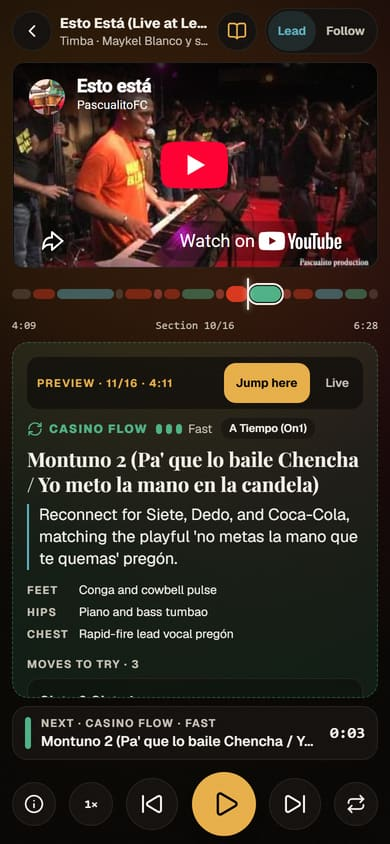
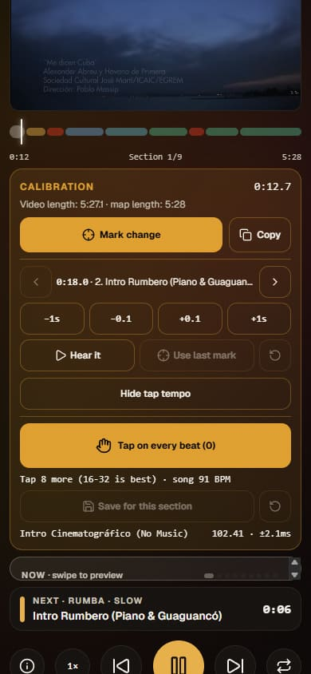
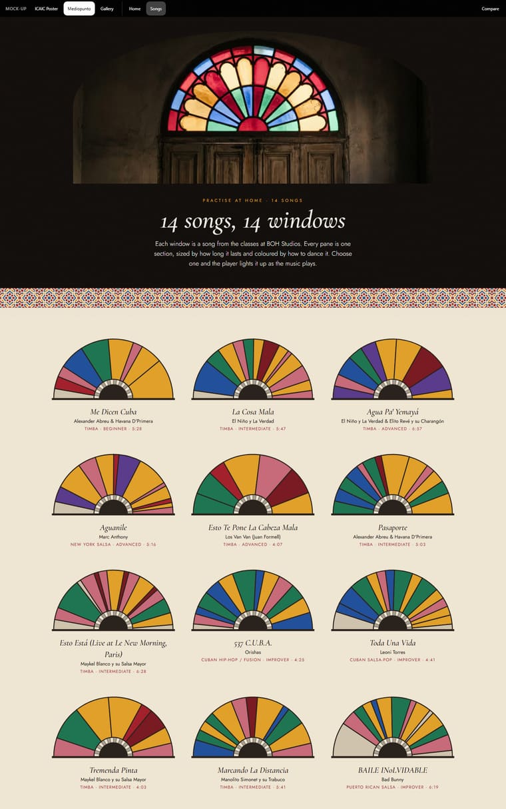

# Case study: teaching a phone to say what to dance

*RitmoFlow, the practice app for Salsa Explosion, a Cuban salsa school in Bournemouth (UK).*
*Built by Dragostin J. · Next.js 16, TypeScript, Prisma/Postgres, Clerk, Stripe, YouTube IFrame API.*

---

## The problem

In Cuban salsa (*casino*) a song changes character every 20–40 seconds:
- a calm verse (dance smooth, conversational figures);
- a chorus that lifts the energy;
- a brass *mambo* (let go and shine);
- a *despelote* breakdown (hands off, body movement).

Good dancers *hear* these changes. Beginners don't, so in class they keep doing the same steps whatever the
music does.

The studio's founder, Maestro Enrique Perez Valdes, plays the same songs every Thursday and Sunday. The idea:
let students practise those songs at home, with the phone telling them **what to dance now** and **what's
coming next**, timed to the music.

### Constraints that shaped everything
- **It's used on a phone, while dancing.** One screen, no scrolling, big buttons in thumb reach, readable at a
  glance.
- **The music is on YouTube.** The studio doesn't own recordings, so songs play through YouTube's official
  player. That means following YouTube's terms: the video is never covered, never hidden while playing, never
  smaller than 200×200 px, and no other audio is mixed over it.
- **Timing is the whole product.** A card that changes 3 seconds late is worse than no card.
- **A real business with fixed rules.** Weekly classes are paid at the door (£12 / £14), never online; only
  festivals sell tickets online.

---

## The player

- **One clock.** The YouTube player's own time is the only clock in the app. Every card, countdown, loop and
  preview reads from it, so if the video buffers or you scrub, the cues follow. There is no separate timer that
  can drift.
- **NOW and NEXT.** The NOW card shows the section's "dance gear" (smooth casino, shines, despelote…), timing,
  cues for leader or follower, and moves to try. The NEXT strip counts down and pulses "Get ready" in the last
  4 seconds.
- **Practice tools.**
  - loop a section, slow the song down, swipe to preview other sections;
  - "Learn", "Dance" and "Ear quiz" modes;
  - a share button that links to an exact section (`?section=…`, starting 2 s early).
- **Zero scroll.** The whole player fits a 390 × 844 phone screen, enforced by an automated design audit.

 

---

## Getting the timings: from AI guesses to trusted maps

**14 songs · 169 sections · 75 minutes of music.** Timing them by hand would take days, so I used AI, and then
had to make the AI trustworthy.

### 1. The first attempt: confident and wrong
The first maps came from the Gemini chat app. They looked plausible, but the user noticed they were 2–3 seconds
off. On one song the model admitted it couldn't hear the audio: it was estimating from YouTube captions, and that
video had none.

### 2. A proper "song maker"
I moved the job to **Google AI Studio**, with the video attached as audio and video input and a **response schema**
generated from the app's own Zod enums, so the model can only output values the app accepts. The system
instructions are generated from code too, and a unit test fails if they drift from the schema.

### 3. Guards for every mistake I caught
Each real failure became an importer check with a test:

| What the model did | What the importer does now |
|---|---|
| Copied the previous song's video id and length (same chat) | Error: that video already belongs to another song |
| Wrote `1:18` as `118` seconds after the first minute | Repairs from its own `m:ss` text, but only if that turns a broken timeline into a valid one |
| Invented a video id (`vanvantemba`) | Warns: real ids are random, single-case letters only are suspicious |
| Counted half-beats (202 BPM for a ~100 BPM song) | Warns outside 60–140 BPM; the instructions now define BPM as the dancer's step |
| Put adjectives where a rueda call belongs | Drops anything that isn't a real call |
| Bar counts that don't fit the section length | Warns: bars should be ≈ length × BPM / 240 |

### 4. Benchmarking models instead of trusting one
On one song whose old map was known to be guesswork, I ran the same prompt through different models:

| Run | Matched the reference section starts (±1.5 s) |
|---|---|
| Gemini 4 Argon, run 1 vs run 2 (two separate tools) | **9 of 11**, all within 0.5 s |
| Gemini Pro Latest | 4 of 11 (and it filled gaps with suspiciously regular 20 s blocks) |
| The old map | 0 of 11 |

On a second song, Gemini Flash found the same 7 big moments as Argon but pattern-filled in between. Verdict:
Argon times the maps, and agreement between two models marks the moments you can trust.

### 5. Then a human, but an efficient one

Opening a song with `?calibrate=1` turns the player into a curator's tool:
- "Mark change" when you *hear* a section change;
- nudge a start by ±0.1 s or ±1 s and hear it again;
- copy a report to paste back into the data.

**Tap tempo** uses some maths. One tap is 30–50 ms off, which is too rough to place beats. So the app fits a
straight line (*time = phase + beat × period*) through all the taps with least squares:
- missed beats are handled by numbering taps from the median interval;
- clear mis-taps are dropped before a second fit.

In tests, 32 taps that are each up to ±40 ms off place the beats within about **10 ms**.

 

---

## Performance: finding leaks by measuring

- **A 96 KB bundle leak.** An automated bundle report showed a 122 KB chunk on the player page containing *every
  song's* data. The cause was two small helper imports (a move lookup and a time formatter) living in the same
  module as the song catalogue. I moved them, and the player's JavaScript went from **1,202 KB to 1,106 KB**. It
  also stopped growing with every song added.
- **A layout jump the user called "breaks a bit".** Instead of guessing, I played section changes in a headless
  browser and logged sizes every 400 ms. The NEXT strip grew from 55 to 71 px on 360 px phones when "Get ready ·
  Casino smooth · Medium" wrapped, and the last section swapped in a shorter box. The fix was a fixed-height strip
  that never wraps. Re-measured: **0 px movement**.
- **Images.** Every image is catalogued with its real size and aspect ratio (no layout shift). The 11 editorial
  photos went from 33 MB to 3 MB, and the hero swaps between a phone crop and a desktop crop with `<picture>`.

---

## Security and reliability

- **Access.** Server actions check roles through shared helpers (not only in the middleware), and student queries
  are scoped to the signed-in user, with **IDOR tests** proving a student can't read or cancel someone else's
  booking.
- **Headers.** An enforced Content-Security-Policy, plus a Permissions-Policy that blocks what the app never uses
  but keeps the camera for the QR check-in scanner.
- **Email.** Signed (HMAC) unsubscribe links with RFC 8058 one-click unsubscribe. GET only shows a confirmation;
  only POST changes anything.
- **Cron.** A daily job (class reminders, weekly digest) behind a secret that **fails closed** when it isn't set.
- **Abuse.** Anonymous practice statistics are rate-limited.
- **Database.** I found Row Level Security disabled on all tables and prepared a reviewed plan. Enabling it costs
  nothing for the app (Prisma connects as the table owner) and closes the public API.

---

## Working with AI agents (and checking their work)

I worked with three AI tools, each in its own lane:

| Tool | Role |
|---|---|
| **Claude Code** | Features, reviews, verification. |
| **Gemini in AI Studio** | Song timing and image generation. |
| **Google Antigravity** | Long unattended briefs: tests, upgrades, reports. |

A written contract ([`AGENTS.md`](../AGENTS.md)) holds the business rules, design tokens and quality gates. Every
agent works on a branch, and nothing merges without passing all the gates.

The most useful lesson came from reviewing an agent's overnight branch. To quieten test warnings it had
**removed the live Content-Security-Policy**, and its security test still passed, because the header's name
appeared in a code comment. My brief had said "don't add a CSP", without realising one already existed. Fixes:
- restore the header;
- make the test read the headers the config actually returns (and prove it fails without them);
- write future briefs that say "keep existing protections".

**Takeaway: trust the gates, not the report.**

---

## Results

| | |
|---|---|
| Songs mapped | 14 (169 sections, 75 min) |
| Unit tests | 350 (53 files): importer, tap tempo, IDOR, role escalation, webhooks, CSP… |
| E2E | Playwright specs for player tools, route guards, layout shift; plus a design audit at desktop and mobile |
| CI | Types, lint, tests and build on every branch push; a weekly check that the YouTube videos still exist |
| In use | Shown on phones at a live dance event; songs and features chosen with the studio |

---

## What's next

- **Art direction.** Three clickable directions inspired by Cuban art: 1960s ICAIC film posters, Havana
  stained-glass *mediopunto* windows, and a gallery style. In the Mediopunto direction every song is drawn as a
  stained-glass window: each pane is a section, sized by its length and coloured by how to dance it. The studio
  is choosing now.
- **A move library.** Shines, rumba, body movement and combos, linked back to the song sections where they fit.
  Because sections have bar counts, the app can say "this combo fits this montuno exactly".
- **An on-screen beat count** (1-2-3, 5-6-7), from the tap-tempo grids.
- **Multiple schools.** The same tools for other dance schools.

 

## What I'd tell another developer
1. **When an AI does the data entry, build the checks before you need them.** Every guard in the importer came
   from a real mistake.
2. **Measure, then fix.** The bundle leak and the layout jump were both invisible to reading the code.
3. **Write the business rules down where the tools can see them.** "Never sell weekly classes online" held through
   hundreds of AI-generated changes because it was in the contract and in the tests.
