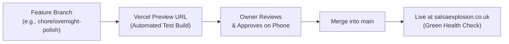

# Salsa Explosion UK & RitmoFlow — Owner's Operating Handbook

Welcome to your operational handbook for **Salsa Explosion UK** and the **RitmoFlow** interactive dance platform. This guide is written in plain English for Maestro Enrique Perez Valdes and the studio operations team. It explains how to manage your songs, run classes, calibrate timings, verify database security, and keep your live website running smoothly.

---

## 1. Adding or Re-Timing a Song

RitmoFlow includes an automated song analysis tool called **Argus** that listens to Cuban salsa, timba, and son tracks on YouTube, breaks them into musical dance sections (Intro, Verse, Coro, Guía, Mambo, Montuno, Despelote), and generates full choreography and timing maps.

### Step-by-Step Workflow
1. Open Google AI Studio Playground in your web browser.
2. Follow the one-time configuration steps detailed in the full guide at [`docs/ai-studio-song-maker/README.md`](./ai-studio-song-maker/README.md).
3. **Important Tip:** Always start a **brand-new chat** for each song. Do not reuse a previous conversation, otherwise the AI may accidentally carry over the video ID or timestamps from the previous track.
4. Attach the official YouTube video using the **+** (Attach) button and select **YouTube video**.
5. Copy the generated JSON song map and provide it to your engineering assistant or paste it directly into `/instructor/song-maps`.

> [!TIP]
> **Two songs per chat message:** When reviewing or refining song timings with an AI assistant, provide at most **two songs per message**. This ensures the assistant focuses deeply on every beat and transition without truncating response outputs.

---

## 2. Ear Calibration on a Mobile Phone

Even the smartest AI can occasionally misjudge a subtle percussion transition by half a second. You can fine-tune and calibrate any song map directly from your smartphone during practice.

### How to Calibrate on Your Phone
1. Open any song on your mobile phone and append `?calibrate=1` to the address bar:
   - Example: `https://salsaexplosion.co.uk/music/me-dicen-cuba?calibrate=1`
2. **Use Phone Speakers, Never Bluetooth:**
   - Always listen through your phone's built-in speaker or wired earphones. Bluetooth headphones introduce a 150ms to 300ms audio latency lag that will throw off your visual and physical timing.
3. **Use the Calibration Controls:**
   - **Mark Change:** Tap this button the exact instant you hear the gear change (e.g., when the Montuno kicks in).
   - **Nudge Buttons (`-1s`, `-0.1s`, `+0.1s`, `+1s`):** Fine-tune the boundary forwards or backwards in micro-increments until the section card highlights in perfect sync with the clave.
   - **Tap Tempo:** Tap four times on the pulse of the conga to measure the authentic BPM.
   - **Copy:** Tap "Copy Timing JSON" to paste the updated timestamps directly back to your team.
4. **Safety Guarantee:** Calibration adjustments made in your phone's browser only affect your local session. When you visit without `?calibrate=1`, the canonical published timings are preserved.

---

## 3. Teaching & Studio Tools

RitmoFlow is designed to make studio evenings at BOH Studios effortless for instructors:

1. **Tonight's Songs on Class Rosters (`/instructor/roster`):**
   - View your live student attendance for Thursday and Sunday sessions.
   - Tag specific curriculum songs to tonight's session so students immediately know which track they danced to.
2. **Check-In Song Links (`/checkin/[sessionId]`):**
   - As students check in at the BOH Studios front desk, the display shows the featured warm-up and social songs.
3. **Practice Hotspots Hub (`/music`):**
   - Direct students to specific musical moments (such as navigating the transition from Contratiempo to Mambo).
4. **Section Share Links:**
   - In any song player, tap the **Share** button on any section (e.g., "Share Coro 2"). This copies a direct link with `?section=<id>` that opens the player and starts the video at that exact second.

---

## 4. Going Live (From Idea to Production)

Whenever new features or song timings are prepared, follow this safe deployment workflow:

### How to Check When a Deployment is Finished
1. Log in to your [Vercel Dashboard](https://vercel.com).
2. Look at the **Deployments** tab for `SalsaExplosion`.
3. A glowing green dot and "Ready" status means your changes are live worldwide.
4. Verify by visiting `https://salsaexplosion.co.uk/api/health`: it will return `{"status":"healthy","uptime":...}` with HTTP 200.

---

## 5. Environment Variables Guide

Environment variables are configuration switches stored safely in Vercel. They allow the website to talk to Stripe, Clerk, Supabase, and Google Gemini without storing secret passwords in public code.

> [!CAUTION]
> **Never share secret values or paste them into public chat rooms.** In Vercel, navigate to **Project Settings → Environment Variables** to view or update these settings.

| Variable Name | Required? | Where to Set | What It Does | What Breaks If Missing |
| :--- | :--- | :--- | :--- | :--- |
| `DATABASE_URL` | **Required** | Vercel (Production/Preview) | Supabase PostgreSQL database connection pooler URL. | The entire database goes offline; schedule, roster, and bookings show errors. |
| `NEXT_PUBLIC_APP_URL` | **Required** | Vercel (All environments) | Canonical site domain (`https://salsaexplosion.co.uk`). | OpenGraph preview cards, SEO schemas, and Stripe return redirects break. |
| `NEXT_PUBLIC_CLERK_PUBLISHABLE_KEY` | **Required** | Vercel (All environments) | Clerk frontend public key for student sign-in and user profiles. | Student sign-in buttons fail to load. |
| `CLERK_SECRET_KEY` | **Required** | Vercel (All environments) | Clerk backend secret key for validating authenticated server actions. | Instructors and admins cannot view protected student rosters or studio tools. |
| `CLERK_WEBHOOK_SECRET` | **Required** | Vercel (Production) | Secret used to verify identity sync webhooks from Clerk. | New student accounts created on Clerk will not sync into your database. |
| `STRIPE_SECRET_KEY` | **Required** | Vercel (Production) | Secret API key for processing festival passes (e.g., Made in Cuba 2026). | Online checkout for weekend dance festivals and passes fails. |
| `STRIPE_WEBHOOK_SECRET` | **Required** | Vercel (Production) | Verifies instant ticket issuance webhooks after payment. | Students pay on Stripe but do not receive digital tickets or confirmation passes. |
| `CRON_SECRET` | **Required** | Vercel (Production) | Secret authorization token for automated background tasks. | Automated midnight cleanup, class reminders, and weekly digests return HTTP 401. |
| `RESEND_API_KEY` | Optional | Vercel (Production) | API key for Resend email delivery service. | Class reminders and digital receipts are logged in dry-run mode instead of sending. |
| `EMAIL_FROM` | Optional | Vercel (Production) | Verified sending email (e.g. `info@salsaexplosion.co.uk`). | Defaults to internal fallback address. |
| `EMAIL_LINK_SECRET` | Optional | Vercel (Production) | Cryptographic salt for one-click unsubscribe links in emails. | Unsubscribe links in notification emails fail validation. |
| `ADMIN_EMAILS` | **Required** | Vercel (Production) | Comma-separated list of staff emails receiving owner digests. | Automatic management reports and notifications have no recipients. |
| `GEMINI_API_KEY` | Optional | Vercel (Production) | Google Gemini API key for AI Studio flyer and video analysis. | Flyer uploader uses deterministic fallback data instead of live vision parsing. |
| `NEXT_PUBLIC_SUPABASE_URL` | Optional | Vercel (Production) | Supabase project URL for media and storage bucket access. | Storage uploads and media assets fall back to local assets. |
| `SUPABASE_SERVICE_ROLE_KEY` | Optional | Vercel (Production) | Administrative key for server-side Supabase operations. | Privileged background storage cleanup is skipped. |
| `ALLOW_DEMO_PAYMENTS` | Optional | Vercel (Preview/Staging) | Set to `"true"` on preview branches to test ticket booking with test cards. | Preview branches require live Stripe payments if unset. |
| `DEMO_SWITCHER_EMAILS` | Optional | Vercel (Preview/Staging) | Emails authorized to switch between Student, Teacher, and Owner view in testing. | Role switcher remains hidden for safety. |

---

## 6. Database Security & Row Level Security (RLS)

Your student records, ticket orders, and class rosters live in a PostgreSQL database hosted on Supabase.

### What `docs/security/enable-rls.sql` Does
- Supabase automatically exposes a public Web API (called PostgREST).
- Running `enable-rls.sql` turns on **Row Level Security (RLS)** across all 19 database tables.
- **Strict Default Deny:** It ensures that anonymous users on the internet cannot query your student lists, phone numbers, or ticket sales directly through browser API requests.
- **Zero Impact on the App:** Because your website communicates securely through Prisma using the database owner credentials (`postgres`), the live site, teachers' roster, and ticket checkout continue working normally with 100% speed.

### When and How to Run It
1. Open your [Supabase Dashboard](https://supabase.com/dashboard).
2. Go to the **SQL Editor**.
3. Open [`docs/security/enable-rls.sql`](./security/enable-rls.sql), copy its contents, paste them into the SQL Editor, and click **Run**.
4. **Verification:** In Supabase, go to **Table Editor**. Every table will display an amber shield icon confirming `RLS Enabled`.
5. **Future Tables Rule:** Whenever a new table is created in future software updates, run `ALTER TABLE public."NewTable" ENABLE ROW LEVEL SECURITY;` to maintain strict zero-trust security.

---

## 7. Troubleshooting Common Issues

### Issue 1: YouTube Video Shows "Video Unavailable"
- **Cause:** YouTube creators occasionally delete, make private, or geo-restrict music videos.
- **Resolution:**
  1. Check the automated GitHub Actions weekly video audit report.
  2. Find an alternative authentic upload of the song on YouTube.
  3. Update the `youtubeVideoId` in `src/lib/constants/timba-song-anatomy.ts` and verify that the start and end timings match the new video.

### Issue 2: Song Timings Feel Slightly Off
- **Cause:** You may be testing with a Bluetooth speaker (latency lag) or YouTube served an alternate version with a longer spoken intro.
- **Resolution:**
  1. Test first on your phone speaker with wired earphones.
  2. If the intro length changed, open the calibration tool (`/music/<song>?calibrate=1`) and nudge the sections to align with the new track.

### Issue 3: Automated Emails Are Not Arriving
- **Cause:** `RESEND_API_KEY` is not set in Vercel, or the sender domain has not finished DNS DKIM verification.
- **Resolution:**
  1. Check Vercel logs for `[email] dry run (no RESEND_API_KEY)`. If you see this, add your Resend API key to Vercel Environment Variables.
  2. Check your Resend dashboard at [resend.com](https://resend.com) to verify that `salsaexplosion.co.uk` shows a green **Verified** domain status.

### Issue 4: Cron Jobs Return HTTP 401 Unauthorized
- **Cause:** The Vercel Cron invocation header does not match your configured `CRON_SECRET`.
- **Resolution:**
  1. Go to Vercel Project Settings → Environment Variables.
  2. Confirm `CRON_SECRET` is set and matches the bearer secret configured in your automated monitoring service.
