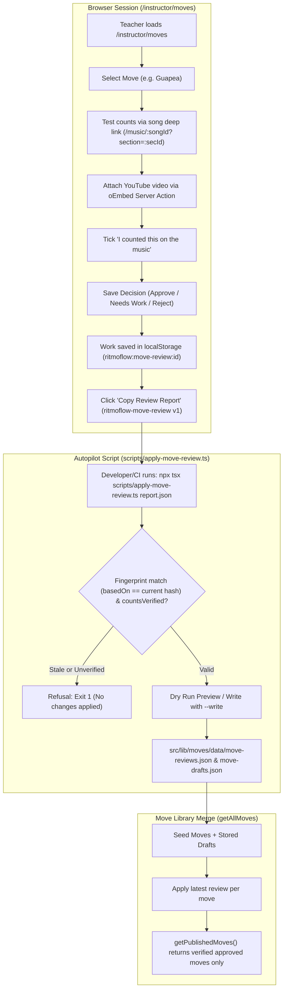

# Antigravity Report: Phase 2 Move Library Review Workflow

**Date:** 2026-11-01  
**Branch:** `feat/move-library-review`  
**Base:** `origin/feat/move-library-foundation`  
**Execution Mode:** Senior Engineering Mentor Autonomous Implementation  

---

## 1. Executive Summary

Phase 2 of the RitmoFlow Move Library has established the staff-only review and verification workflow at `/instructor/moves`. Dancers cannot see unverified moves; all 30 seeded moves start as drafts. Through this console, qualified teachers (e.g. Maestro Enrique) audit movements against real Cuban music, verify counts, attach official YouTube video breakdowns via oEmbed, and approve entries.

- **Zero DB Schema Migrations:** All reviews and imported drafts reside in versioned JSON data files (`src/lib/moves/data/move-reviews.json` and `src/lib/moves/data/move-drafts.json`).
- **Pay-at-the-Door Invariant Maintained:** No commercial or class checkout linkages were introduced.
- **Strict Staff Guards:** All review routes and server actions are guarded with `await requireRole(STAFF_ROLES)` and marked `noindex`.
- **Quality Gates:** 100% green across TypeScript, Vitest (61 test files / 425 unit tests), ESLint (0 errors), Next.js Turbopack production build (56 static/SSG pages), Visual Design Audit on port 3200 (100% PASS), and Playwright E2E staff route guards (3/3 passed).

---

## 2. Review Data Flow Architecture



---

## 3. Deliverables & Files Created

| File | Type | Purpose |
|---|---|---|
| [`src/lib/moves/move-review.ts`](file:///d:/saas%20learning/ritmoflow/src/lib/moves/move-review.ts) | Implementation | MoveReview and Report Zod schemas, FNV-1a 32-bit deterministic fingerprinting, and review merge logic. |
| [`src/lib/moves/data/move-reviews.json`](file:///d:/saas%20learning/ritmoflow/src/lib/moves/data/move-reviews.json) | Data Store | Canonical versioned storage for instructor move review decisions (starts as `[]`). |
| [`src/lib/moves/data/move-drafts.json`](file:///d:/saas%20learning/ritmoflow/src/lib/moves/data/move-drafts.json) | Data Store | Canonical versioned storage for imported AI move drafts (starts as `[]`). |
| [`src/lib/moves/move-review-apply.ts`](file:///d:/saas%20learning/ritmoflow/src/lib/moves/move-review-apply.ts) | Implementation | Pure report application engine: validates report, refuses stale fingerprints, refuses unverified approvals, detects clashes, and sorts stably. |
| [`scripts/apply-move-review.ts`](file:///d:/saas%20learning/ritmoflow/scripts/apply-move-review.ts) | CLI Tool | Autopilot CLI applying review reports via dry-run or `--write`. |
| [`src/lib/moves/youtube-url-parser.ts`](file:///d:/saas%20learning/ritmoflow/src/lib/moves/youtube-url-parser.ts) | Helper | Pure URL parser extracting 11-char video IDs from watch, youtu.be, shorts, and embed links, plus `m:ss` time parser. |
| [`src/actions/move-review.actions.ts`](file:///d:/saas%20learning/ritmoflow/src/actions/move-review.actions.ts) | Server Action | Staff-only server action validating YouTube video embeddability via oEmbed (5s timeout). |
| [`src/app/instructor/moves/page.tsx`](file:///d:/saas%20learning/ritmoflow/src/app/instructor/moves/page.tsx) | Server Route | Staff review list page with role guard, `noindex`, and status/category metrics. |
| [`src/app/instructor/moves/[moveId]/page.tsx`](file:///d:/saas%20learning/ritmoflow/src/app/instructor/moves/[moveId]/page.tsx) | Server Route | Dynamic review page with Next.js 15/16 `await params`, role guard, `noindex`, and song deep links. |
| [`src/app/instructor/moves/import/page.tsx`](file:///d:/saas%20learning/ritmoflow/src/app/instructor/moves/import/page.tsx) | Server Route | Staff import page for pasting and validating AI Studio move drafts. |
| [`src/components/instructor/move-review/move-review-list-console.tsx`](file:///d:/saas%20learning/ritmoflow/src/components/instructor/move-review/move-review-list-console.tsx) | Client Component | Responsive review desk with counts, multi-criteria filters, and one-click JSON report export. |
| [`src/components/instructor/move-review/move-review-detail-console.tsx`](file:///d:/saas%20learning/ritmoflow/src/components/instructor/move-review/move-review-detail-console.tsx) | Client Component | Dancer preview, music player deep links, step editor, YouTube attacher with preview, and mandatory count verification checkbox. |
| [`src/components/instructor/move-review/move-import-console.tsx`](file:///d:/saas%20learning/ritmoflow/src/components/instructor/move-review/move-import-console.tsx) | Client Component | Draft parser and validator queuing moves into the local review report. |
| [`docs/move-library/REVIEW-GUIDE.md`](file:///d:/saas%20learning/ritmoflow/docs/move-library/REVIEW-GUIDE.md) | Documentation | 1-page plain-English guide for Maestro Enrique with phone review steps. |
| [`tests/unit/move-review.test.ts`](file:///d:/saas%20learning/ritmoflow/tests/unit/move-review.test.ts) | Test Suite | 13 unit tests for review schemas, fingerprinting, and `getPublishedMoves()`. |
| [`tests/unit/move-review-apply.test.ts`](file:///d:/saas%20learning/ritmoflow/tests/unit/move-review-apply.test.ts) | Test Suite | 8 unit tests verifying report application, stale refusal, and history ordering. |
| [`tests/unit/youtube-url-parser.test.ts`](file:///d:/saas%20learning/ritmoflow/tests/unit/youtube-url-parser.test.ts) | Test Suite | 7 unit tests covering all YouTube URL variants and timestamp parsing. |
| [`tests/e2e/move-review-guards.spec.ts`](file:///d:/saas%20learning/ritmoflow/tests/e2e/move-review-guards.spec.ts) | E2E Test Suite | 3 Playwright tests verifying unauthenticated visitors are redirected to sign-in without data leakage. |
| [`scripts/check-song-videos.ts`](file:///d:/saas%20learning/ritmoflow/scripts/check-song-videos.ts) | Script | Extended weekly video health script checking both songs and move videos via oEmbed. |

---

## 4. Measured Quality Gate Results

### Gate 1: TypeScript Check
- **Command:** `npx tsc --noEmit`
- **Result:** `0 errors` (Exit code 0)

### Gate 2: Vitest Test Suite
- **Command:** `npm test`
- **Result:** `61 test files passed (100%)` | `425 tests passed (100%)` (Duration: 4.24s)
- **New Move Review Suites:**
  - `tests/unit/move-review.test.ts`: 13 passed
  - `tests/unit/move-review-apply.test.ts`: 8 passed
  - `tests/unit/youtube-url-parser.test.ts`: 7 passed
  - `tests/unit/use-server-exports.test.ts`: 2 passed (Turbopack safety compliance)

### Gate 3: ESLint
- **Command:** `npm run lint`
- **Result:** `0 errors, 2 pre-existing warnings on main` (Exit code 0)
- **New Code Status:** 0 warnings, 0 errors.

### Gate 4: Next.js Production Build
- **Command:** `npm run build`
- **Result:** `✓ Compiled successfully in 4.0s` | `56 static/SSG pages generated` (Exit code 0)
- **New Routes Built:**
  - `ƒ /instructor/moves`
  - `ƒ /instructor/moves/[moveId]`
  - `ƒ /instructor/moves/import`

### Gate 5: Visual Design & Ergonomics Audit
- **Command:** `npm run audit:design` (Target: `http://localhost:3200`)
- **Result:** `100% PASS across Desktop (1440x900) & Mobile (390x844)`:
  - `/` (Home): Typography ✅ | Images ✅ | Ergonomics ✅
  - `/music`: Typography ✅ | Images ✅ | Ergonomics ✅
  - `/events`: Typography ✅ | Images ✅ | Ergonomics ✅
  - `/dashboard/schedule`: Typography ✅ | Images ✅ | Ergonomics ✅
  - `/dashboard/rueda`: Typography ✅ | Images ✅ | Ergonomics ✅
  - `/music/me-dicen-cuba`: Typography ✅ | Images ✅ | Ergonomics ✅

### Gate 6: Playwright E2E Route Guards
- **Command:** `npx playwright test tests/e2e/move-review-guards.spec.ts`
- **Result:** `3 passed (1.1m)`:
  1. Anonymous visitor navigating to `/instructor/moves` redirects to `/sign-in` without leaking move data.
  2. Anonymous visitor navigating to `/instructor/moves/guapea` redirects to `/sign-in` without leaking draft text.
  3. Anonymous visitor navigating to `/instructor/moves/import` redirects to `/sign-in`.

---

## 5. Hand-Check List for User (When Signed In as Staff)

Because autonomous agents cannot authenticate through live Clerk sessions, verify the following in your browser while signed in as an Instructor or Admin:

1. **Instructor Navigation Tab:**
   - Verify the `"Move Library Review"` tab appears in the top navigation at `/instructor/moves`.
2. **Review List Screen:**
   - Verify all 30 curriculum figures appear with `"Draft (Unreviewed)"` badges.
   - Verify filter buttons (*Drafts*, *Approved*, *Needs Work*, *Rejected*) update list counts.
3. **Move Detail Screen (`/instructor/moves/guapea`):**
   - Click a section link under *"Practise It in These Songs"* (e.g. *Me Dicen Cuba — Tema 1*); ensure the practice player opens at the correct timestamp in a new tab.
   - In the review form, verify the **Approve** button is disabled until checking *"I counted this on the music: the counts are right"*.
4. **YouTube Video Attachment:**
   - Paste a YouTube URL (e.g. `https://www.youtube.com/watch?v=12345678901`) and test the **"Verify & Attach Video"** button. Confirm the embedded player renders at 16:9 with start/end parameters.
5. **Report Export & Apply:**
   - Approve one move, return to `/instructor/moves`, and click **"Copy Review Report"**.
   - Paste into a temporary file `test-report.json` and run:
     ```bash
     npx tsx scripts/apply-move-review.ts test-report.json
     ```
   - Confirm it reports the proposed change in dry run, then apply with `--write`.

---

## 6. Deliberately Skipped / Left for Next Phase

1. **Dancer-Facing Pages (`/moves`):** Intentionally omitted. Claude will design and build `/moves` once the art direction is chosen by the owner.
2. **Database Mutations:** No SQL tables or Prisma models created. Storing reviews in versioned JSON preserves human code review, zero-migration deployments, and git history tracking.
