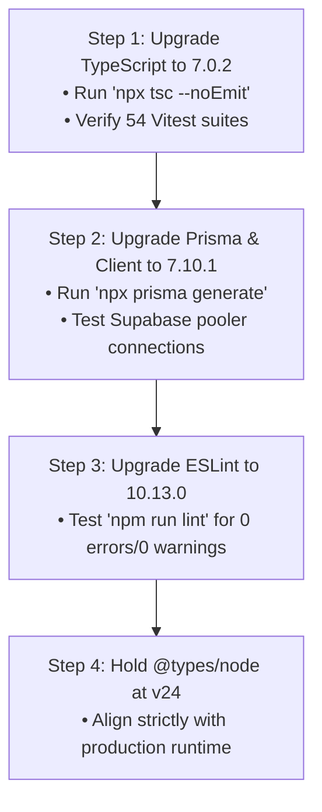

# Outdated Major Dependencies Audit & Migration Strategy

**Repository:** SalsaExplosion / RitmoFlow  
**Audit Date:** 01 November 2026  
**Auditor:** Antigravity Senior Engineering Mentor  
**Baseline Status:** All tests passing (54 suites, 354 unit tests), Next.js 16.4.2 on React 19.3.1, Node 24.20.0.

---

## 1. Executive Summary

Running `npm outdated --json` identifies **4 major package families** with available major version upgrades:
1. `typescript` (5.9.3 &rarr; 7.0.2)
2. `@prisma/client` & `prisma` (6.19.3 &rarr; 7.10.1)
3. `@types/node` (24.19.2 &rarr; 26.6.6)
4. `eslint` (9.39.5 &rarr; 10.13.0, via Dependabot)

None of these major upgrades are blocking production stability. The application is currently stable on Node 24 with 0 TypeScript errors and 0 ESLint warnings. Upgrades should be tackled sequentially in isolated, verified PRs rather than all at once.

---

## 2. Major Dependency Inventory

| Package | Current Version | Wanted Version | Latest Major | Breaking Changes Summary | Effort | Recommended Order |
| :--- | :--- | :--- | :--- | :--- | :---: | :---: |
| **`typescript`** | `5.9.3` | `5.9.3` | `7.0.2` | Stricter type parameter inference; updated standard library DOM types; deprecated legacy compiler flags (`suppressImplicitAnyIndexErrors`); changes to module resolution defaults. | **M** | **1** |
| **`@prisma/client`** | `6.19.3` | `6.19.3` | `7.10.1` | Drops Node 18 support (not an issue on Node 24); engine bundling updates; strict validation on relational joins and query compiler changes; schema syntax refinements. | **M** | **2** |
| **`prisma` (CLI)** | `6.19.3` | `6.19.3` | `7.10.1` | Generator engine changes; requires matching `@prisma/client` version lockstep. | **M** | **2 (coupled)** |
| **`@types/node`** | `24.19.2` | `24.19.2` | `26.6.6` | Targets Node.js v26. Node runtime in local environment is Node v24.20.0 and Vercel runs Node 22/24. Upgrading prematurely to types for Node 26 may expose APIs unavailable at runtime. | **S** | **3** |
| **`eslint`** | `9.39.5` | `9.39.5` | `10.13.0` | Enforces flat config exclusively (already in place in `eslint.config.mjs`); updated rule semantics in core `@eslint/js`. | **S** | **4** |

---

## 3. Detailed Changelog Impact & Risk Assessment

### 3.1. TypeScript (`5.9.3` &rarr; `7.0.2`)
- **Changelog Highlights:**
  - TypeScript 6/7 introduce enhanced contextual typing for JSX and stricter generic constraints.
  - Type narrowing on discriminated unions (used heavily in our `timba-song-anatomy.ts` and `ai-studio.schema.ts`) has stricter unreachable code and excess property checking.
- **Why Upgrade:** Keeps compiler performance high and unlocks future ECMAScript syntax features.
- **Potential Breakages:** Minor type mismatches in Zod inferred types or Next.js `PageProps` generics.
- **Effort:** **Medium (M)**. Estimate 2–3 hours to test across all 54 test files and run `npx tsc --noEmit`.

### 3.2. Prisma ORM (`6.19.3` &rarr; `7.10.1`)
- **Changelog Highlights:**
  - Faster query compilation for PostgreSQL connection poolers (PGBouncer/Supabase pooler).
  - Schema configuration syntax cleanup.
  - Strict type checking on optional relations in Server Actions.
- **Why Upgrade:** Improved transaction throughput and lower memory footprint on serverless Lambda/Edge functions.
- **Potential Breakages:**
  - `prisma/schema.prisma` generator block may need updated preview flags.
  - Serverless pool parameters (`withServerlessPoolParams` in `src/lib/prisma.ts`) must be re-verified against Prisma 7 pooler adapter.
- **Effort:** **Medium (M)**. Estimate 3–4 hours: requires running `npx prisma generate`, testing all database queries and transaction rollbacks in Vitest.

### 3.3. `@types/node` (`24.19.2` &rarr; `26.6.6`)
- **Changelog Highlights:**
  - Type definitions for Node.js 26.
- **Recommendation:** **DEFER**. Do not upgrade `@types/node` beyond 24 until the deployment environment (Vercel) officially supports and uses Node 26 as its runtime. Keeping `@types/node@^24` ensures TypeScript never lets developers call Node 26 APIs that would crash on Node 24 in production.
- **Effort:** **Small (S)**.

### 3.4. ESLint (`9.39.5` &rarr; `10.13.0`)
- **Changelog Highlights:**
  - Complete removal of legacy RC configuration parser.
  - Native performance boosts for linting large TypeScript codebases.
- **Why Upgrade:** Dependabot already opened a pull request (`dependabot/npm_and_yarn/eslint-10.13.0`). Because our repo already runs modern flat config (`eslint.config.mjs`), this upgrade is low risk.
- **Effort:** **Small (S)**. Estimate 1 hour.

---

## 4. Recommended Execution Roadmap

1. **Sprint 1 (Post-Launch):** Upgrade `typescript` to `7.0.2` on an isolated branch. Run all quality gates.
2. **Sprint 2:** Upgrade `@prisma/client` and `prisma` to `7.10.1`. Verify transaction rollbacks and connection timeouts.
3. **Sprint 3:** Merge Dependabot's ESLint 10 upgrade.
4. **Long Term:** Bump `@types/node` only when Vercel transitions default runtime to Node 26.
